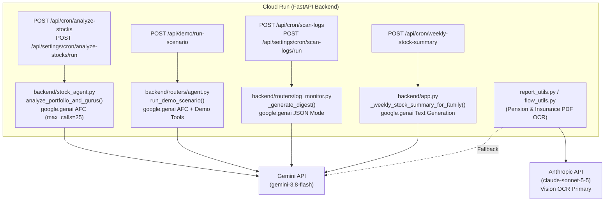

# Architecture & Model Upgrade Plan: Remove `LangChain` (`google-genai` Direct) & Late-2026 Model Upgrade

> **Status:** Approved — Executing PR 1 (`refactor/remove-langchain`)
> **Date:** October 2026
> **Document:** `docs/remove-langchain-and-model-upgrade.md`
> **Scope:**
> - **PR 1 (`refactor/remove-langchain`):** Replace `LangChain` / `LangGraph` (and temporary `google-adk` / `vertexai` artifacts) with direct `google-genai` SDK calls across `stock_agent.py`, `stock_agent_tools.py`, `routers/agent.py`, and `routers/log_monitor.py`. Remove all `.invoke()` LangChain remnants.
> - **PR 2 (`feat/upgrade-models-2026`):** Benchmark and upgrade `GEMINI_MODEL_NAME` (`gemini-3.8-flash`) and `CLAUDE_MODEL_NAME` (`claude-sonnet-5-5`), and migrate the weekly Hebrew stock summary email (`app.py`) from Claude to Gemini.

---

## 1. Executive Summary & Architectural Decision Record (ADR)

### 1.1 Why We Are Dropping `Vertex AI Agent Engine` & `google-adk`

An earlier draft proposed migrating the Stock Analysis Agent from `LangGraph` to **Google ADK (`google-adk`)** deployed on **Vertex AI Agent Engine (Reasoning Engine)**. After auditing the codebase and production workload, we **reject** that approach for four reasons:

1. **Cold-start is already solved in-process:** [`backend/routers/agent.py`](../backend/routers/agent.py#L41-L46) uses lazy imports (`_load_agent_deps()`), so heavy agent libraries are never loaded on standard API requests—only when the cron or manual/demo endpoint runs.
2. **Zero benefit from remote `Agent Engine`:** Deploying a separate Reasoning Engine in `us-central1` while Cloud Run runs in `me-west1` introduces cross-region network latency, a second CI/CD deployment target, Vertex AI IAM permissions, and recurring GCP compute charges—replacing a workload that currently runs for **$0.00** inside the Cloud Run Free Tier.
3. **Cross-run `session_id` memory is counterproductive:** Deduplication of 13F guru alerts is already handled deterministically in Firestore (`db_manager.get_sent_13f_alert_keys()` / `db_manager.mark_13f_alert_sent()` in [`backend/routers/agent.py`](../backend/routers/agent.py#L161-L197)). Retaining conversational history across runs inflates input token costs and risks confusing the model with stale stock prices from prior runs.
4. **Native `google-genai` Automatic Function Calling is already installed:** The backend already uses `google-genai` (`1.75.0` installed in `.venv`) across 5 modules (`flow_utils.py`, `rag_utils.py`, `dashboard_chat.py`, `documents.py`, `insurance.py`). Its native `client.models.generate_content()` method supports **Automatic Function Calling (AFC)** out of the box—accepting plain Python functions, executing tool loops automatically, respecting `maximum_remote_calls`, and recording the full call/response trace in `response.automatic_function_calling_history`.

### 1.2 Target Architecture



---

## 2. Current Git State & Branch / Cleanup Strategy

### 2.1 Current Working Tree vs. `master`
The workspace is currently on branch `feat/gemini-adk-stock-agent` (created from `feat/pension-last-updated`, 1 commit ahead of `master` `a7f6f30`) with uncommitted changes from the aborted Phase 1 `ADK` prototype:

| File | State in `master` (`a7f6f30`) | State in Current Working Tree | Target State for PR 1 |
|---|---|---|---|
| `backend/agent_adapter.py` | Does not exist | Untracked (`??`) | **Delete** |
| `backend/agent_stock_adk.py` | Does not exist | Untracked (`??`) | **Delete** |
| `backend/tests/test_agent_adapter.py` | Does not exist | Untracked (`??`) | **Delete** |
| `backend/stock_agent_tools.py` | All 5 production tools + 5 demo tools use `@tool` from `langchain_core.tools` | Modified (`M`): `@tool` replaced by `@_add_invoke_adapter` on 5 production tools; `build_demo_tools` still uses `@tool` | Plain Python functions everywhere (both production tools and `build_demo_tools`); **remove `_add_invoke_adapter`** |
| `backend/stock_agent.py` | Uses `ChatGoogleGenerativeAI` + `create_react_agent` | Unmodified (same as `master`) | Uses `google.genai` with Automatic Function Calling |
| `backend/routers/agent.py` | Imports `analyze_portfolio_and_gurus` from `stock_agent`; uses `.invoke()` on `scan_guru_portfolio`; `run_demo_scenario` uses `langgraph` | Modified (`M`): imports `run_stock_agent` from `agent_adapter` and passes `session_id=f"user_{uid}"` | Imports `analyze_portfolio_and_gurus` from `stock_agent` (no `session_id`); calls `scan_guru_portfolio(guru_name=...)` directly; `run_demo_scenario` uses `google.genai` |
| `backend/routers/log_monitor.py` | `_generate_digest` uses `ChatGoogleGenerativeAI`, `SystemMessage`, `HumanMessage` | Unmodified (same as `master`) | `_generate_digest` uses `google.genai` with `response_mime_type="application/json"` |
| `backend/requirements.txt` | Contains `langchain*` and `langgraph`, `google-genai>=1.0.0` | Modified (`M`): `langchain*`/`langgraph` removed, `google-adk` & `vertexai` added | Remove `langchain*`, `langgraph`, `google-adk`, `vertexai`; pin `google-genai>=1.75.0` |
| `backend/tests/routers/test_agent.py` | Calls `.invoke({...})` on tools and `AIMessage` in `_extract_run_summary` test | Modified (`M`): added `session_id` assertion | Remove `session_id` assertion; call plain tool functions directly; test `_extract_run_summary` with `google.genai` AFC history |

### 2.2 Clean Branching Steps (Avoiding Carrying Unwanted Dirty State)
Because `git checkout -b` carries uncommitted tracked modifications (`M`) into the new branch, we will execute the following explicit sequence once approved:
1. Delete the three untracked ADK files (`backend/agent_adapter.py`, `backend/agent_stock_adk.py`, `backend/tests/test_agent_adapter.py`) — *requires explicit user confirmation per File Deletion rule*.
2. Discard the temporary ADK edits on tracked files (`git checkout -- backend/routers/agent.py backend/tests/routers/test_agent.py backend/requirements.txt backend/stock_agent_tools.py`) — or `git stash` if we prefer to keep a backup in the stash list.
3. Checkout a clean branch directly from `master`:
   ```powershell
   git checkout -b refactor/remove-langchain master
   ```
4. Apply the PR 1 changes cleanly on `refactor/remove-langchain`.

---

## 3. PR 1 Specification: Remove `LangChain` & `LangGraph` (`refactor/remove-langchain`)

### 3.1 Complete Audit of `LangChain` / `LangGraph` Usages in `backend/`

A full search across `backend/**/*.py` identified every reference to `langchain`, `langgraph`, `google-adk`, and `vertexai`:

1. **[`backend/stock_agent.py`](../backend/stock_agent.py)**
   - Lines 29–31: `from langchain_core.messages import HumanMessage, SystemMessage`, `from langchain_google_genai import ChatGoogleGenerativeAI`, `from langgraph.prebuilt import create_react_agent`.
   - Lines 94–165 (`_extract_run_summary(messages_history: list, start_time: float) -> AgentRunSummary`): Inspects LangGraph's `messages_history` (`msg.tool_calls` and `msg.content`).
   - Lines 238–271 (`_build_agent_executor`): Builds `ChatGoogleGenerativeAI` + `create_react_agent`.
   - Lines 374–428 (inside `analyze_portfolio_and_gurus`): Invokes `_build_agent_executor()`, passes `[HumanMessage(content=human_input)]` with `config={"recursion_limit": AGENT_RECURSION_LIMIT}`, extracts `summary = _extract_run_summary(result["messages"], start_time)`, and reads `result["messages"][-1]`.
2. **[`backend/stock_agent_tools.py`](../backend/stock_agent_tools.py)**
   - All 5 production tools (`get_us_stock_data`, `get_il_stock_data`, `search_financial_news`, `send_telegram_alert`, `scan_guru_portfolio`) and the 5 demo tools inside `build_demo_tools(scenario_name: str)` (lines 159–208) use `@tool` from `langchain_core.tools` (or `@_add_invoke_adapter` in the current working tree).
3. **[`backend/routers/agent.py`](../backend/routers/agent.py)**
   - Line 155 (inside `_analyze_stocks_for_family`): Calls `scan_guru_portfolio.invoke({"guru_name": guru_name})`.
   - Lines 289–338 (inside `run_demo_scenario`, `POST /api/demo/run-scenario`): Imports `HumanMessage, AIMessage, ToolMessage`, `ChatGoogleGenerativeAI`, and `create_react_agent`, runs `agent.invoke(...)`, and builds `logs` from `result["messages"]`.
4. **[`backend/routers/log_monitor.py`](../backend/routers/log_monitor.py)**
   - Lines 277–278 (inside `_generate_digest`): Imports `ChatGoogleGenerativeAI` from `langchain_google_genai` and `HumanMessage, SystemMessage` from `langchain_core.messages`.
   - Lines 319–333: Calls `llm.invoke([SystemMessage(content=system_prompt), HumanMessage(content=user_message)])`.
5. **[`backend/requirements.txt`](../backend/requirements.txt)**
   - Remove `langchain`, `langchain-google-genai`, `langgraph`, `google-adk`, and `vertexai`. Pin `google-genai>=1.75.0`.

---

### 3.2 Detailed File-by-File Changes for PR 1

#### A. [`backend/stock_agent_tools.py`](../backend/stock_agent_tools.py)
- **Remove `@tool` and remove `_add_invoke_adapter` completely:** No `LangChain` remnants will remain in production code.
- **5 Production Tools** (`get_us_stock_data`, `get_il_stock_data`, `search_financial_news`, `send_telegram_alert`, `scan_guru_portfolio`):
  - Plain Python functions with their existing type hints (`ticker: str -> str`, `message: str, chat_id: str = "" -> str`, `guru_name: str -> str`) and docstrings.
- **5 Demo Tools in `build_demo_tools(scenario_name: str) -> list` (lines 159–208):**
  - Remove `from langchain_core.tools import tool` and all `@tool` decorators from the 5 inner functions:
    1. `get_us_stock_data(ticker: str) -> str`
    2. `get_il_stock_data(ticker: str) -> str`
    3. `scan_guru_portfolio(guru_name: str) -> str`
    4. `search_financial_news(ticker: str) -> str`
    5. `send_telegram_alert(message: str, chat_id: str = "") -> str`
  - Keep their exact signatures, parameter types, and docstrings so `google.genai` Automatic Function Calling can introspect them identically to `AGENT_TOOLS`.

#### B. [`backend/stock_agent.py`](../backend/stock_agent.py)
- **Imports:** Replace `langchain_core`, `langchain_google_genai`, and `langgraph` imports with:
  ```python
  from google import genai
  from google.genai import types
  ```
- **Tool Registry (`AGENT_TOOLS`):** Remains unchanged:
  ```python
  AGENT_TOOLS = [
      get_us_stock_data,
      get_il_stock_data,
      scan_guru_portfolio,
      search_financial_news,
      send_telegram_alert,
  ]
  ```
- **`_extract_run_summary(afc_history: list, start_time: float) -> AgentRunSummary`:**
  - Preserve the exact `AgentRunSummary` Pydantic model fields (`tickers_checked`, `total_alerts_sent`, `price_alerts_sent`, `risk_alerts_sent`, `alpha_alerts_sent`, `tool_errors`, `gurus_scanned`, `price_alert_tickers`, `run_duration_seconds`, `success`) and all existing extraction rules.
  - Instead of iterating over LangGraph `AIMessage` / `ToolMessage` objects, iterate over `afc_history` (`response.automatic_function_calling_history or []`), which is a `list[types.Content]`:
    ```python
    for content in (afc_history or []):
        for part in (getattr(content, "parts", None) or []):
            # 1. Model tool call (Part.function_call)
            fc = getattr(part, "function_call", None)
            if fc:
                name = fc.name or ""
                args = dict(fc.args or {})

                if name in ("get_us_stock_data", "get_il_stock_data"):
                    ticker = str(args.get("ticker", "")).strip()
                    if ticker:
                        tickers_checked.append(ticker)

                elif name == "send_telegram_alert":
                    total_alerts += 1
                    alert_text = str(args.get("message", ""))
                    if "PRICE ALERT" in alert_text:
                        price_alerts += 1
                        m = _PRICE_ALERT_TICKER_RE.search(alert_text)
                        if m:
                            price_alert_tickers.append(m.group(1).strip())
                    elif "RISK ALERT" in alert_text:
                        risk_alerts += 1
                    elif "ALPHA IDEA" in alert_text:
                        alpha_alerts += 1

                elif name == "scan_guru_portfolio":
                    guru = str(args.get("guru_name", "")).strip()
                    if guru:
                        gurus_scanned.append(guru)

            # 2. Tool execution response (Part.function_response)
            fr = getattr(part, "function_response", None)
            if fr and isinstance(fr.response, dict):
                # google-genai wraps plain function return values in {"result": <val>}
                # or {"error": <err>}
                res_val = fr.response.get("result") or fr.response.get("error") or ""
                if isinstance(res_val, str) and res_val.startswith("ERROR"):
                    tool_errors.append(res_val[:300])
    ```
- **Entry Point (`analyze_portfolio_and_gurus`):**
  - **Keep the exact signature and prompt construction unchanged:**
    ```python
    def analyze_portfolio_and_gurus(
        user_portfolio_tickers: list[str],
        pre_analyzed_guru_data: dict[str, str] | None = None,
        telegram_chat_id: str = "",
    ) -> dict[str, Any]:
    ```
  - All logic building `tickers_formatted`, `notification_instruction`, and `human_input` (both `pre_analyzed_guru_data is None` and pre-computed 13F branches) remains 100% untouched.
  - Inside the `try:` block (lines 372–438), replace `_build_agent_executor()` + `agent.invoke(...)` with:
    ```python
    start_time = time.time()
    api_key = os.getenv("GEMINI_API_KEY", "").strip()
    if not api_key:
        raise EnvironmentError(
            "GEMINI_API_KEY is not set. "
            "Cannot initialise the Financial Analyst Agent."
        )

    client = genai.Client(api_key=api_key)
    response = client.models.generate_content(
        model=config.GEMINI_MODEL_NAME,
        contents=human_input,
        config=types.GenerateContentConfig(
            system_instruction=SYSTEM_PROMPT,
            temperature=0,
            tools=AGENT_TOOLS,
            automatic_function_calling=types.AutomaticFunctionCallingConfig(
                maximum_remote_calls=AGENT_RECURSION_LIMIT,
            ),
        ),
    )

    afc_history = getattr(response, "automatic_function_calling_history", None) or []
    summary = _extract_run_summary(afc_history, start_time)
    ```
  - Keep all post-run validation warnings (`skipped` tickers check, `extraneous` price-alert ticker hallucination check, `summary.tool_errors` warning) untouched.
  - Extract final text output directly via `output = (response.text or "").strip()`.
  - Return `{"output": output, "success": True, "summary": summary.model_dump()}`.

#### C. [`backend/routers/agent.py`](../backend/routers/agent.py)
- **`_load_agent_deps()` (lines 41–46):**
  - Restore import from `stock_agent`:
    ```python
    def _load_agent_deps():
        global analyze_portfolio_and_gurus, TRACKED_GURUS, scan_guru_portfolio
        if scan_guru_portfolio is None:
            from stock_agent import analyze_portfolio_and_gurus as _analyze
            from stock_agent_tools import TRACKED_GURUS as _gurus, scan_guru_portfolio as _scan
            analyze_portfolio_and_gurus, TRACKED_GURUS, scan_guru_portfolio = _analyze, _gurus, _scan
    ```
- **`_analyze_stocks_for_family(uid: str)` (lines 152–193):**
  - Call `scan_guru_portfolio(guru_name=guru_name)` directly (no `.invoke()`).
  - Call `analyze_portfolio_and_gurus` without `session_id`:
    ```python
    result = analyze_portfolio_and_gurus(
        user_portfolio_tickers=tickers,
        pre_analyzed_guru_data=guru_results,
        telegram_chat_id=telegram_chat_id,
    )
    ```
- **`run_demo_scenario` (`POST /api/demo/run-scenario`, lines 267–345):**
  - Replace `langchain_core` / `langchain_google_genai` / `langgraph` imports with `from google import genai` and `from google.genai import types`.
  - Keep `mock_tools = build_demo_tools(scenario_name)` and the exact `human_input` prompt string.
  - In `_run()`:
    ```python
    def _run():
        start = time.time()
        client = genai.Client(api_key=api_key)
        response = client.models.generate_content(
            model=config.GEMINI_MODEL_NAME,
            contents=human_input,
            config=types.GenerateContentConfig(
                system_instruction=SYSTEM_PROMPT,
                temperature=0,
                tools=mock_tools,
                automatic_function_calling=types.AutomaticFunctionCallingConfig(
                    maximum_remote_calls=AGENT_RECURSION_LIMIT,
                ),
            ),
        )
        logs = []
        for content in (getattr(response, "automatic_function_calling_history", None) or []):
            for part in (getattr(content, "parts", None) or []):
                fc = getattr(part, "function_call", None)
                if fc:
                    logs.append({
                        "type": "tool_call",
                        "name": fc.name,
                        "args": dict(fc.args or {}),
                    })
                fr = getattr(part, "function_response", None)
                if fr:
                    resp_dict = fr.response if isinstance(fr.response, dict) else {}
                    content_val = resp_dict.get("result", resp_dict.get("error", ""))
                    logs.append({
                        "type": "tool_result",
                        "name": fr.name,
                        "content": str(content_val),
                    })
        final_text = (response.text or "").strip()
        if final_text:
            logs.append({"type": "final_output", "content": final_text})
        return {"logs": logs, "duration_seconds": round(time.time() - start, 1)}
    ```
  - **Note on `"name"` key:** Preserves `"name"` (not `"tool"`) in `tool_call` and `tool_result` log entries to match the existing contract with the frontend presentation page.

#### D. [`backend/routers/log_monitor.py`](../backend/routers/log_monitor.py)
- **`_generate_digest(grouped_text: str, scan_from: str, scan_to: str) -> dict[str, str]` (lines 265–343):**
  - Remove `from langchain_google_genai import ChatGoogleGenerativeAI` and `from langchain_core.messages import HumanMessage, SystemMessage`.
  - Import `from google import genai` and `from google.genai import types`.
  - Keep `system_prompt` and `user_message` unchanged.
  - Inside `try:`:
    ```python
    import config
    client = genai.Client(api_key=api_key)
    response = client.models.generate_content(
        model=config.GEMINI_MODEL_NAME,
        contents=user_message,
        config=types.GenerateContentConfig(
            system_instruction=system_prompt,
            temperature=0,
            response_mime_type="application/json",
        ),
    )
    raw = (response.text or "").strip()
    result = _json.loads(raw)
    ```
  - Keep the shape check (`if "telegram_message" in result and "email_html" in result:`) and `_fallback_digest(...)` error handling unchanged.

#### E. [`backend/requirements.txt`](../backend/requirements.txt)
- Remove `langchain`, `langchain-google-genai`, `langgraph`, `google-adk`, and `vertexai`.
- Update `google-genai>=1.0.0` to `google-genai>=1.75.0` to match the project `.venv` without forcing a major `2.x` upgrade in PR 1.

#### F. Unit Tests (`backend/tests/routers/test_agent.py` & `backend/tests/test_log_monitor.py`)
1. **[`backend/tests/routers/test_agent.py`](../backend/tests/routers/test_agent.py):**
   - In `_run()` helper (lines 32–35): change `mock_scan.invoke.return_value = guru_output` to `mock_scan.return_value = guru_output`, and remove `assert mock_analyze.call_args.kwargs.get("session_id") == f"user_{uid}"`.
   - In `test_build_demo_tools_returns_five_tools_with_mock_data` and `test_build_demo_tools_unknown_ticker_falls_back` (lines 96–114): index tools by `t.__name__` instead of `t.name`, and call `by_name["get_us_stock_data"](ticker="AAPL")` directly instead of `.invoke(...)`.
   - In news & guardrail tests (lines 134, 146, 157, 163, 169, 175): call `search_financial_news(ticker="AAPL")`, `get_us_stock_data(ticker="not a ticker!!")`, `get_il_stock_data(ticker="AAPL")`, `send_telegram_alert(message="   ", chat_id="123")` directly.
   - In `test_summary_captures_price_alert_ticker`: replace `AIMessage` from `langchain_core.messages` with `google.genai.types.Content` entries in `afc_history` and verify `_extract_run_summary` extracts `price_alert_tickers == ["AAPL"]`, `tickers_checked`, `gurus_scanned`, and `tool_errors`.
   - Add direct unit tests for `analyze_portfolio_and_gurus` including `maximum_remote_calls` exhaustion (`_has_unresolved_function_calls` failing closed with `success=False`).
2. **[`backend/tests/test_log_monitor.py`](../backend/tests/test_log_monitor.py):**
   - Add direct unit tests for `_generate_digest`:
     - `test_generate_digest_parses_valid_gemini_json_response`: mocks `google.genai.Client` returning valid JSON `{"telegram_message": "...", "email_html": "..."}` and asserts `response_mime_type="application/json"` was configured.
     - `test_generate_digest_falls_back_on_gemini_exception`: mocks `google.genai.Client` raising an error and asserts `_fallback_digest` output is returned safely.

---

## 4. Model Pricing & Cost Analysis (October 2026)

| Model Identifier | Role in AI Wealth Monitor | Input Price (per 1M tokens) | Output Price (per 1M tokens) | Verification Notes |
|---|---|---|---|---|
| `gemini-3.7-flash` *(current)* | Chat, RAG, Stock Agent, Log Monitor, OCR Fallback | *Unlisted on current public pricing page* (legacy `compare_ocr.py` assumed `$0.15`) | *Unlisted on current public pricing page* (legacy `compare_ocr.py` assumed `$0.60`) | Even if `3.7-flash` was billed at legacy `$0.15 / $0.60` rates, total monthly text/agent volume across all crons is `<100K` tokens (`<$0.15/month`). |
| `gemini-3.8-flash` *(new)* | Target upgrade for all Gemini tasks | **$0.75** *(intro through Dec 2026)*<br/>**$1.50** *(from Jan 2027)* | **$3.75** *(intro through Dec 2026)*<br/>**$7.50** *(from Jan 2027)* | Official October 2026 pricing. Significantly higher per-token rate than legacy `2.5-flash` (`$0.15 / $0.60`), so `compare_ocr.py` must be updated accordingly. |
| `claude-sonnet-4-6` *(current)* | Primary PDF Vision OCR (`report_utils.py`, `flow_utils.py`) & Weekly Summary (`app.py`) | **$3.00** | **$15.00** | Highest per-token cost in the system. |
| `claude-sonnet-5-5` *(new)* | Target upgrade for Primary PDF Vision OCR | **$2.00** | **$10.00** | **33% cost reduction** on both input and output tokens compared to `claude-sonnet-4-6`. |

### Cost Impact Summary
1. **PDF Vision OCR (`claude-sonnet-4-6` $\rightarrow$ `claude-sonnet-5-5`):** Reduces per-report token cost by **33%** (`$3/$15` $\rightarrow$ `$2/$10`). Because Vision OCR on multi-page pension PDFs is the dominant token consumer in the app, this is the largest real cost saver—pending empirical verification of Hebrew RTL table accuracy via `compare_ocr.py`.
2. **Weekly Stock Summary Email (`app.py`, Claude $\rightarrow$ `gemini-3.8-flash`):**
   - Compared to `claude-sonnet-4-6` (`$3 / $15`), `gemini-3.8-flash` is **75% cheaper in 2026** (`$0.75 / $3.75`) and **50% cheaper from Jan 2027** (`$1.50 / $7.50`).
   - Compared to `claude-sonnet-5-5` (`$2 / $10`), `gemini-3.8-flash` is **~62% cheaper through Dec 2026** and **~25% cheaper starting Jan 2027**.
3. **Gemini Text / Agent Tasks (`gemini-3.7-flash` $\rightarrow$ `gemini-3.8-flash`):**
   - If `gemini-3.7-flash` was previously billed at legacy Flash rates (`$0.15 / $0.60`), moving to `gemini-3.8-flash` (`$0.75 / $3.75` in 2026; `$1.50 / $7.50` in 2027) is a 5x–10x per-token increase, though negligible in absolute dollar terms (`<$0.50/month` for a single family tracker). We will benchmark `gemini-3.8-flash` vs `gemini-3.7-flash` before switching `config.GEMINI_MODEL_NAME`.

---

## 5. PR 2 Specification: Benchmark & Model Upgrades (`feat/upgrade-models-2026`)

**PR 2** will be opened on a separate branch (`feat/upgrade-models-2026`) after PR 1 is merged, following a strict **measure-first** workflow:

### Step 1: Update & Run the OCR Benchmark ([`backend/scripts/compare_ocr.py`](../backend/scripts/compare_ocr.py))
1. Update the pricing constants in [`backend/scripts/compare_ocr.py`](../backend/scripts/compare_ocr.py#L25-L33):
   - Claude (`claude-sonnet-5-5`): `$2.00 / 1M` input, `$10.00 / 1M` output (and keep `$3.00 / $15.00` for `claude-sonnet-4-6` comparison).
   - Gemini (`gemini-3.8-flash`): `$0.75 / 1M` input, `$3.75 / 1M` output (2026 intro rate; note `$1.50 / $7.50` 2027 rate in comments).
2. Run `compare_ocr.py` on real Hebrew pension/insurance PDF reports and compare:
   - Field-level extraction accuracy (balances, management fees, track names, policy numbers, RTL string ordering).
   - Wall-clock latency per report.
   - Actual dollar cost per report.

### Step 2: Update Model Identifiers in [`backend/config.py`](../backend/config.py)
Only after Step 1 confirms that `claude-sonnet-5-5` (and `gemini-3.8-flash` as fallback) match or beat current extraction quality:
```python
CLAUDE_MODEL_NAME = "claude-sonnet-5-5"
GEMINI_MODEL_NAME = "gemini-3.8-flash"
```

### Step 3: Migrate Weekly Stock Summary Email in [`backend/app.py`](../backend/app.py)
- In `_weekly_stock_summary_for_family(uid: str)` ([`backend/app.py`](../backend/app.py#L1115-L1248)):
  - Read the API key via `os.environ.get("GEMINI_API_KEY")` (matching the rest of the codebase; `config.py` does not store API keys):
    ```python
    gemini_api_key = os.environ.get("GEMINI_API_KEY")
    if not gemini_api_key:
        print("❌ [CRON] GEMINI_API_KEY not found in environment variables!")
        return {"status": "error", "reason": "GEMINI_API_KEY not configured."}
    ```
  - Replace `from anthropic import Anthropic` and `client.messages.create(...)` with `google.genai`:
    ```python
    from google import genai
    from google.genai import types

    client = genai.Client(api_key=gemini_api_key)
    response = client.models.generate_content(
        model=config.GEMINI_MODEL_NAME,
        contents=final_prompt,
        config=types.GenerateContentConfig(
            system_instruction="אתה יועץ השקעות מומחה. ניתוח תיק מניות שבועי עבור לקוח.",
            temperature=0.5,
            max_output_tokens=4096,
        ),
    )
    ai_text = (response.text or "").strip()
    ```
  - Inspect a sample Hebrew output before merging to verify natural Hebrew phrasing and Markdown formatting.
  - Update unit tests in [`backend/tests/test_cron.py`](../backend/tests/test_cron.py#L107-L188) (`test_weekly_stock_summary_for_family_skips_cash_and_skips_email_on_no_events` and `test_weekly_stock_summary_for_family_sends_email_on_significant_events`) to patch `google.genai.Client` and set `GEMINI_API_KEY` in `os.environ`.

---

## 6. Verification & Done Checklist

### PR 1 Checklist (`refactor/remove-langchain`)
- [x] Untracked ADK files (`backend/agent_adapter.py`, `backend/agent_stock_adk.py`, `backend/tests/test_agent_adapter.py`) deleted with user approval.
- [x] Dirty working-tree edits reset/stashed and `refactor/remove-langchain` branched cleanly from `master`.
- [x] Zero references to `langchain`, `langgraph`, `google.adk`, `vertexai`, or `_add_invoke_adapter` anywhere in `backend/`.
- [x] `AutomaticFunctionCallingConfig(maximum_remote_calls=AGENT_RECURSION_LIMIT)` (`25` remote calls, equivalent to 50 LangGraph super-steps) configured in `stock_agent.py` and `routers/agent.py` (`run_demo_scenario`), failing closed if `maximum_remote_calls` is exhausted (`_has_unresolved_function_calls`).
- [x] `analyze_portfolio_and_gurus(user_portfolio_tickers, pre_analyzed_guru_data, telegram_chat_id)` preserves its exact signature, prompt construction, and post-run validations.
- [x] `_extract_run_summary` (`stock_agent.py`) accurately parses `response.automatic_function_calling_history` via shared `iter_afc_parts` helper for `get_us_stock_data`, `get_il_stock_data`, `scan_guru_portfolio`, `send_telegram_alert` (`PRICE ALERT`, `RISK ALERT`, `ALPHA IDEA`), and `"ERROR"` tool responses.
- [x] `run_demo_scenario` (`routers/agent.py`) preserves `"name"` (not `"tool"`) in `tool_call` and `tool_result` log dicts.
- [x] `_generate_digest` (`routers/log_monitor.py`) migrated to `google.genai` with `response_mime_type="application/json"`.
- [x] `backend/requirements.txt` cleaned and pinned to `google-genai>=1.75.0`.
- [x] Direct unit tests added for `_generate_digest` in `backend/tests/test_log_monitor.py`, and all tests in `backend/tests/routers/test_agent.py` updated to call plain tool functions directly.

### PR 2 Checklist (`feat/upgrade-models-2026`)
- [ ] `backend/scripts/compare_ocr.py` updated with verified October 2026 token pricing and executed on real Hebrew PDFs.
- [ ] `backend/config.py` updated to `CLAUDE_MODEL_NAME = "claude-sonnet-5-5"` and `GEMINI_MODEL_NAME = "gemini-3.8-flash"` based on benchmark results.
- [ ] `_weekly_stock_summary_for_family` in `backend/app.py` migrated to `google.genai` using `os.environ.get("GEMINI_API_KEY")` and verified on Hebrew output.
- [ ] `backend/tests/test_cron.py` and full backend test suite pass.
